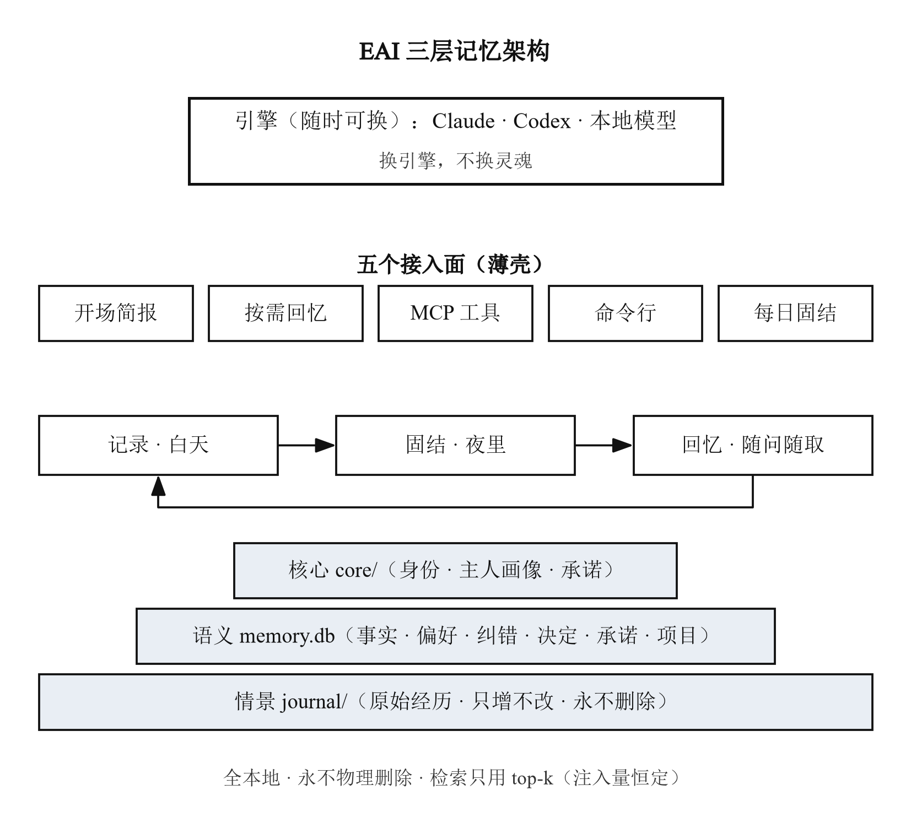
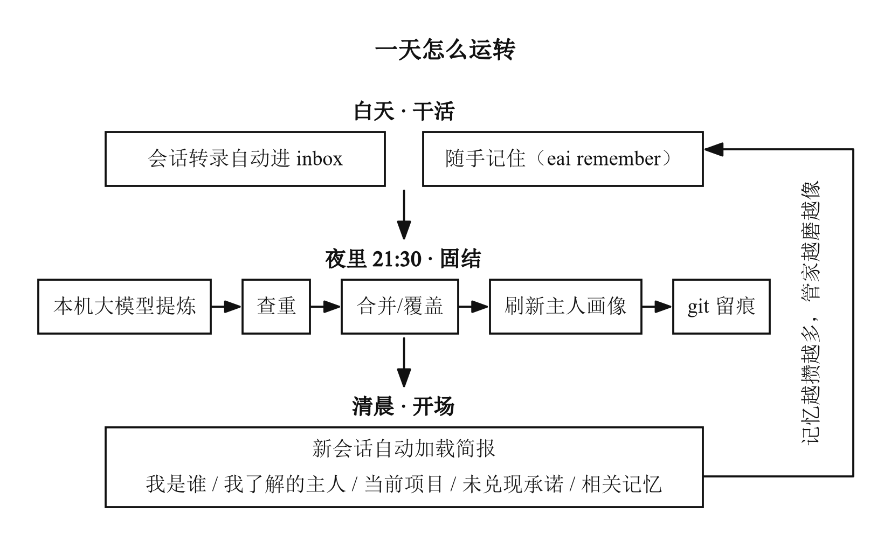

# EAI · 私人管家（AI 长期记忆系统）

[](https://github.com/yellowyyyu/EAI/actions/workflows/tests.yml)
[](https://github.com/yellowyyyu/EAI/releases)

> **模型是引擎，记忆和人格是灵魂。** 换任何 AI，接上同一套记忆，就是同一个管家。
> *Model is the engine; memory and persona are the soul.*

现在的大模型每次新会话都从零开始，训练完参数就冻结。EAI 把"记忆"和"人格"从模型里搬出来，存成你自己电脑上的数据文件：**越用越懂你，且永不遗忘**。

| 大模型的现状 | 接上 EAI 之后 |
|--------------|----------------|
| 每次新会话从零开始 | 开场自动"恢复成人"：知道你是谁、在做什么、红线是什么 |
| 记忆一多就爆上下文 | 只按需注入最相关的一页（实测：记忆 1000 条→简报 1368 字符；10000 条→1383 字符） |
| 纠过的错下次照犯 | 纠错入库；新旧冲突以新为准，旧条归档可考古 |
| 换个模型就像换了个人 | 记忆与人格是数据文件——换引擎，不换灵魂 |

## 特性

- **三层记忆**：情景日志（原始经历，只增不改）→ 语义记忆库（SQLite 全文检索）→ 核心记忆（身份守则 · 主人画像 · 承诺台账）
- **夜间固结**：自动收料（读 Claude / Codex 会话转录，只读原文）→ 提炼 → 查重 → 纠错 → 刷新画像 → git 留痕
- **中文检索**：二元分词 + 覆盖率打分（相关 × 重要 × 新近），用则强化，且防"头部滚雪球"
- **零第三方依赖**：纯 Python 标准库，Windows / macOS / Linux 直接跑
- **本地优先**：数据不出本机；智能固结用本机 Ollama（可选），没有也不残废（自动降级纯规则）
- **习惯档案**：四本档案（说话习惯、词语小词典、图片偏好、任务做法）每次会话自动加载、平时自动维护；长期习惯进档案，事件与决定进记忆，两者互补
- **接入任意 AI**：Claude Code 钩子 + CLAUDE.md 导入 + MCP 工具（recall / remember / memory_stats）；Codex 走 AGENTS.md + MCP；其它 MCP 客户端同样可接
- **永不物理删除**：新旧覆盖链式更新，一切可考古；`memory/` 默认不进 git（那是你的隐私）

## 安装（一条命令）

要求：Python 3.8+、git；有 Claude Code 或 Codex 会自动接入。

**Windows**（PowerShell）：

```powershell
powershell -ExecutionPolicy Bypass -c "irm https://raw.githubusercontent.com/yellowyyyu/EAI/main/tools/bootstrap.ps1 | iex"
```

**macOS / Linux**：

```bash
curl -fsSL https://raw.githubusercontent.com/yellowyyyu/EAI/main/tools/bootstrap.sh | bash
```

装到 `~/EAI`（记忆和人格就长在这里）。重复运行等于升级，不会覆盖已有记忆和档案。

安装器会：初始化记忆库 → 生成开场简报 → 创建四本习惯档案并写入全局说明 → 安装 `eai` 命令（加入用户 PATH）→ 接入 Claude Code（SessionStart 钩子 + MCP）→ 接入 Codex（AGENTS.md + MCP）→ 注册每晚 21:30 自动固结 → 回放历史会话与已有项目记忆（可选）。**每一步可跳过，可重复运行，`--uninstall` 一键撤销（记忆与档案不动）。**

装完新开一个 Claude Code 或 Codex 会话，直接问它：**"报一下你现在记得我什么。"** 角色、你的习惯、以前发生过的事都会自动带上，不需要你再交代一遍。

> 国内网络访问 GitHub 需要代理；也可以手动 `git clone https://github.com/yellowyyyu/EAI.git` 后运行 `python tools/install.py`。

## 快速上手

```
eai remember "周五前把部署脚本整理一版" -k promise   # 记一条（kind: fact/preference/correction/decision/promise/project/skill/episode）
eai recall "部署"                                    # 查记忆（命中即强化）
eai recall --journal "上次讨论"                       # 翻原始经历底稿
eai day                                              # 今日一条龙：收料+固结+画像+留痕
eai brief                                            # 打印开场简报（新会话自动注入的就是它）
eai chat --scope 某项目                               # 跟管家对话（本机模型+记忆）
eai growth --since 7d                                # 成长报告：“这周我学到了什么”
```

（Windows 下也能双击 `tools\管家.bat` 用菜单操作。）

## 工作原理





**三层记忆**：情景日志记"发生过什么"（只增不改）；语义库记"提炼出的事实、偏好、纠错、决定、承诺"；核心层记"管家是谁 + 你是谁 + 有哪些承诺"。
**三循环**：白天记录 → 夜里固结 → 随问随取。检索永远只取最相关的 top-k（注入量恒定），所以**记忆可以无限增长，上下文占用不动**。

细节见 [`docs/设计说明.md`](docs/设计说明.md)。

## 接进每次会话

- **Claude Code**：安装器自动完成三件套——SessionStart 钩子（实时简报）、CLAUDE.md 里的角色 + 四本档案 @引用（每次会话自动加载）、MCP 工具（`recall` / `remember` / `memory_stats`）。
- **Codex**：`~/.codex/AGENTS.md` 写入角色与档案规则（每次会话自动加载，开场自己读简报和四本档案）+ `config.toml` 注册 MCP 工具。
- **Windows 大坑（本项目已内置规避，值得记下）**：Claude Code 执行 SessionStart 钩子走 **PowerShell**，命令写 bash 语法（`||`、`2>/dev/null`）会被**静默拒绝**——必须用 `"shell": "powershell"` + `hook_boot.bat` 包装（见 `tools/install.py`）。
- **其它 MCP 客户端**：命令配成
  `python <仓库路径>/src/eai/mcp_server.py`

## 数据与隐私

- 全部数据在本机 `memory/`：`memory.db`（记忆库）、`journal/`（情景日志）、`inbox/`（收料）、`digests/`（每日摘要）、`core/`（身份与画像，可手改）。
- `.gitignore` 默认排除 `memory/`、`logs/`、`brief_snapshot.md`——**你的记忆不会被误传上 git**。
- 固结默认走本机 `127.0.0.1:11434` 的 Ollama，不联网、不上传；没有任何遥测。

## 目录结构

```
├─ src/eai/            管家本体（零第三方依赖）
├─ templates/          四本习惯档案模板 + 全局说明模板
├─ tools/              采集器、开场钩子、安装器、批处理入口
├─ tests/              核心/采集/MCP 测试（纯标准库 unittest）
├─ figures/            架构图脚本（生成你自己的增长曲线也在这里）
├─ demo/               验收演示（注入恒定 A4 / 检索评测 / 提炼探针）
├─ docs/               设计与使用文档
└─ memory/             ★你的记忆（安装后自动生成；默认不进 git）
```

## FAQ

1. **没有 Ollama？** 固结自动退到快档、再退到纯规则，流程不中断。装上 Ollama 后自动升级。
2. **中文乱码？** 走 `tools/*.bat` 启动（已内置 UTF-8），或设 `PYTHONUTF8=1`。
3. **想在两台电脑用同一个管家？** 见 [`docs/双机同步.md`](docs/双机同步.md)——记住一条：同一时间只让一台电脑跑固结。
4. **记错了怎么办？** `eai remember "更正：……" -k correction`；下次固结自动以新为准，旧条归档备查。
5. **想彻底停用？** `python tools/install.py --uninstall` 撤销全部接入；删掉文件夹即全部消失。

## 开发与反馈

- 变更记录：[CHANGELOG.md](CHANGELOG.md)
- 参与贡献：[CONTRIBUTING.md](CONTRIBUTING.md)
- 问题反馈：[Issues](https://github.com/yellowyyyu/EAI/issues)

## License

[MIT](LICENSE)
